# LAB-002 — Windows Server 2025 Active Directory Deployment

**Category:** Windows Server / Active Directory / Systems Administration  
**Status:** In Progress  
**Environment:** Oracle VirtualBox, Windows Server 2025 Standard Evaluation, Windows 11 Enterprise

## 1. Project Overview

This lab documents the deployment of a Windows Server 2025 Active Directory environment in Oracle VirtualBox. Its purpose is to build practical experience with Windows Server administration, TCP/IP networking, Active Directory Domain Services (AD DS), DNS, PowerShell, and systematic troubleshooting.

The project is being developed incrementally. Completed work and verified results are distinguished from planned exercises.

## 2. Lab Architecture

| Component | Configuration |
|---|---|
| Hypervisor | Oracle VirtualBox 7.2 |
| Domain controller | `DC01` |
| Server OS | Windows Server 2025 Standard Evaluation |
| Active Directory domain | `lab.test` |
| NetBIOS domain | `LAB` |
| Client VM | Windows 11 Enterprise  (`WIN11-LAB001`; joined to `lab.test`) |
| Host-only subnet | `192.168.56.0/24` |
| DC01 host-only interface (`Ethernet 2`) | `192.168.56.10/24` (static; no default gateway) |
| DC01 NAT interface (`Ethernet`) | `10.0.2.15/24` (VirtualBox NAT) |
| Internal DNS server | `192.168.56.10` |

DC01 has two virtual network interfaces. The **host-only adapter** provides connectivity between lab systems, while the **NAT adapter** provides outbound connectivity. The domain controller hosts authoritative DNS for `lab.test`.


> **Design note:** This multihomed configuration is useful for learning, but a single-homed domain controller is generally simpler to administer. We are investigating unwanted DNS registration associated with the NAT adapter.

## 3. Deployment and Verification

### 3.1 Windows Server Installation

Created a Windows Server 2025 Standard Evaluation virtual machine in VirtualBox and completed installation. Configured the VM with NAT and host-only network adapters.

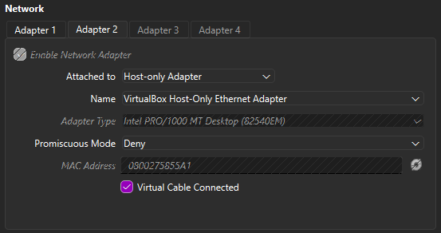

### 3.2 Static Network Configuration

Configured the host-only interface with static IPv4 address `192.168.56.10/24` and no default gateway. Verified that Windows reported the address as manually configured.

The NAT interface provides an outbound path through VirtualBox; the host-only interface is used for internal Active Directory communication.

**Static IPv4 Address Configuration**

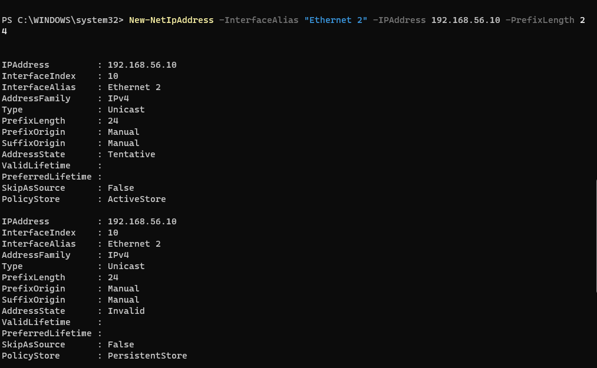

**IPv4 Address Verification**

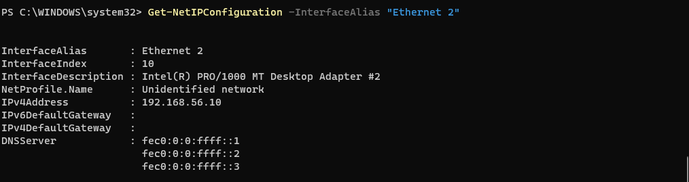

**Static Address Origin Verification**

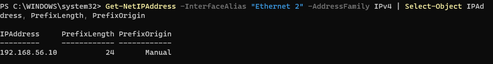

### 3.3 Active Directory Domain Services

Installed the AD DS role and management tools:

```powershell
Install-WindowsFeature -Name AD-Domain-Services -IncludeManagementTools
```

**AD DS Role Installation**

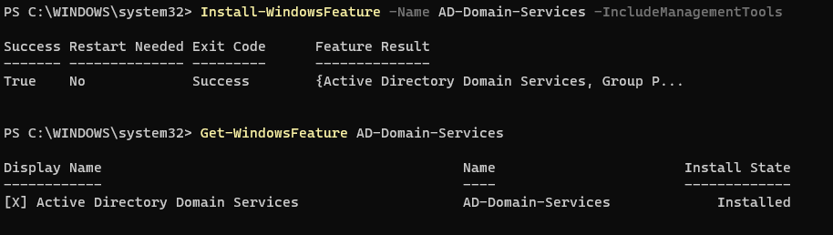

Created a new forest and installed DNS:

```powershell
Install-ADDSForest -DomainName "lab.test" -DomainNetbiosName "LAB" -InstallDNS
```

Verified the resulting domain:

```powershell
Get-ADDomain
```

Confirmed that the `NTDS`, `DNS`, `Netlogon`, and `KDC` services were running.

**Active Directory Domain Verification**


### 3.4 DNS Service Discovery

Queried the domain controller locator SRV record:

```powershell
Resolve-DnsName _ldap._tcp.dc._msdcs.lab.test -Server 192.168.56.10 -Type SRV
```

**DNS SRV Record Verification**

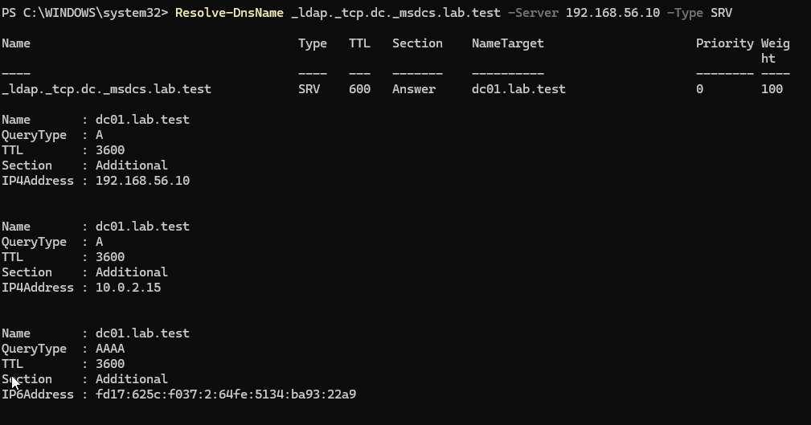

The query identified `dc01.lab.test` as an LDAP service target. Inspection of the DNS response also revealed multiple addresses associated with the domain controller, prompting the troubleshooting investigation below.

## 4. Troubleshooting — Multihomed Domain Controller DNS Registration

### Problem

During Active Directory DNS verification, the domain controller hostname `dc01.lab.test` was found to resolve to multiple IPv4 addresses.

Because DC01 uses separate NAT and host-only network adapters, an address registered from the wrong interface could cause domain clients to attempt connections over an unreachable network.

### Diagnosis

Queried the domain controller's DNS server directly to inspect its registered IPv4 addresses:

```powershell
Resolve-DnsName dc01.lab.test -Type A -Server 192.168.56.10
```

**DNS Records Before Remediation**

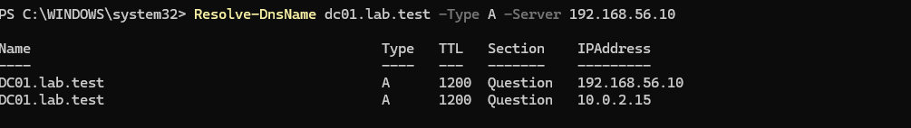

The query returned two A records:

- `192.168.56.10` — the intended host-only address, reachable by lab clients.
- `10.0.2.15` — the NAT adapter address, not directly reachable from the host-only client network.

This confirmed that DC01 was publishing an address unsuitable for the planned client network.

Examined the DNS registration settings for each network interface:

```powershell
Get-DnsClient | Select-Object InterfaceAlias, RegisterThisConnectionsAddress
```
**DNS Registration Results - Before Remediation**

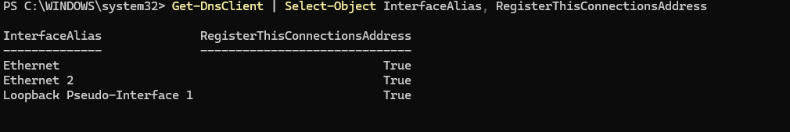

Initially, both Ethernet interfaces permitted DNS address registration. The DNS Server service was also observed listening on multiple addresses. However, listening for DNS queries and registering a server's own addresses in DNS are separate functions.

### Remediation performed

Disabled DNS client address registration on the NAT adapter:

```powershell
Set-DnsClient -InterfaceAlias "Ethernet" -RegisterThisConnectionsAddress $false
```

**NAT Adapter DNS Registration Disabled**

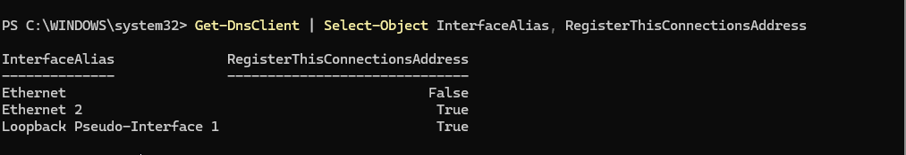

The previously registered NAT-side A record remained in the authoritative zone. Prepared a targeted removal and previewed it without modifying the zone:

```powershell
Remove-DnsServerResourceRecord -ZoneName "lab.test" -Name "dc01" -RRType "A" -RecordData "10.0.2.15" -WhatIf
```

### Initial Remediation and Verification

Executed the removal command without `-WhatIf` and confirmed the deletion.

A subsequent DNS lookup continued to return both A records, including the unwanted NAT address `10.0.2.15`.

```powershell
Resolve-DnsName dc01.lab.test -Type A -Server 192.168.56.10
```

To determine whether the unwanted record remained in the authoritative DNS zone, queried the DNS resource records directly:

```powershell
Get-DnsServerResourceRecord -ZoneName "lab.test" -Name "dc01" -RRType "A" |
Select-Object HostName, RecordType, RecordData
```

The `RecordData` column displayed the object type `DnsServerResourceRecordA` rather than the underlying IPv4 address.

Used a calculated property to extract the IPv4 address from the nested `RecordData` object:

```powershell
Get-DnsServerResourceRecord -ZoneName "lab.test" -Name "dc01" -RRType "A" |
Select-Object HostName, RecordType,
    @{Name="IPAddress";Expression={$_.RecordData.IPv4Address}}
```

This query returned only `192.168.56.10`, indicating that the unwanted NAT address was no longer present in the authoritative zone at the time of inspection.

### Unexpected Result — DNS Record Reappeared

While exploring an alternative method of inspecting nested PowerShell objects, queried the `RecordData` property directly:

```powershell
Get-DnsServerResourceRecord -ZoneName "lab.test" -Name "dc01" -RRType "A" |
Select-Object -ExpandProperty RecordData
```

Unexpectedly, the output contained both IPv4 addresses:

- `192.168.56.10` — intended host-only address
- `10.0.2.15` — unwanted NAT address

Both commands retrieved DNS resource records from the same zone but used different methods to display their properties.

To rule out differences in PowerShell object formatting, repeated the DNS resource record query using both a calculated property and Select-Object -ExpandProperty RecordData.

Both commands returned the same two IPv4 addresses, confirming that the unwanted record was present in the authoritative DNS zone.

This indicated that deleting the existing record had not provided a persistent resolution. Further investigation was required to identify the mechanism responsible for DNS registration.

### Further Investigation — DNS Server Configuration

Verified that DNS client address registration remained disabled on the NAT adapter, despite the unwanted A record returning.

```powershell
Get-DnsClient |
Where-Object InterfaceAlias -in "Ethernet", "Ethernet 2" |
Select-Object InterfaceAlias, RegisterThisConnectionsAddress
```

Examined the IP addresses on which the DNS Server service was configured to listen:

```powershell
Get-DnsServerSetting -All | Select-Object -ExpandProperty ListeningIPAddress
```
The results included both 10.0.2.15 and 192.168.56.10, along with IPv6 addresses.

This confirmed that DNS Server was configured to listen on both IPv4 interfaces. However, DNS listening configuration and DNS record registration are separate functions, so this finding did not establish the cause of the unwanted A record.

Inspected the DNS Server registry configuration:

```powershell
Get-ItemProperty -Path "HKLM:\SYSTEM\CurrentControlSet\Services\DNS\Parameters" -Name PublishAddresses
```
The PublishAddresses registry value was absent, indicating that no explicit address publication restriction had been configured through this setting.

### Controlled Test — DNS Registration

To investigate the recurring DNS record, verified that DNS client registration remained disabled on the NAT adapter.

Removed the unwanted `10.0.2.15` A record and queried the authoritative DNS zone to establish a clean baseline. Only `192.168.56.10` remained.

Triggered a DNS registration refresh:

```powershell
ipconfig /registerdns
```

Queried the authoritative DNS zone again:

```powershell
Get-DnsServerResourceRecord -ZoneName "lab.test" -Name "dc01" -RRType "A" |
Select-Object -ExpandProperty RecordData
```

The unwanted `10.0.2.15` A record had returned.


This reproduced the issue following a DNS registration refresh, despite DNS client registration being disabled on the NAT adapter. The result narrowed the investigation but did not conclusively identify the component responsible for publishing the address.

### Microsoft Documentation — Identifying the Registration Mechanism

Because disabling DNS client registration on the NAT adapter had not prevented the unwanted A record from returning, consulted Microsoft's [KB 2023004 — Avoid registering unwanted NICs in DNS on a multihomed domain controller](https://learn.microsoft.com/en-us/troubleshoot/windows-server/networking/unwanted-nic-registered-dns-mulithomed-dc).

Microsoft identifies three Windows services capable of registering DNS A records on a domain controller:

- DNS Client
- DNS Server
- Netlogon

The documentation explains that DNS Server can register addresses associated with its listening interfaces independently of the DNS client's per-adapter registration setting.

This was consistent with the earlier finding that DNS Server was listening on both `10.0.2.15` and `192.168.56.10`.

Microsoft's recommended remediation includes restricting DNS Server to the intended interface and removing unwanted DNS records.

Based on this guidance, proceeded to modify the DNS Server listening configuration.

Following Microsoft's documented DNS Server configuration procedure, restricted DNS Server to the host-only interface using PowerShell. [Microsoft DNS Server Configuration Guide](https://learn.microsoft.com/en-us/windows-server/networking/dns/quickstart-install-configure-dns-server?tabs=powershell&utm) :

```powershell
$DnsServerSettings = Get-DnsServerSetting -All
$DnsServerSettings.ListeningIPAddress = @("192.168.56.10")
Set-DnsServerSetting -InputObject $DnsServerSettings
```

Verified the configuration:

```powershell
Get-DnsServerSetting -All |
Select-Object -ExpandProperty ListeningIPAddress
```
![DNS Server listening configuration corrected](screenshots/14-dns-registration-verified.png

The output confirmed that DNS Server was listening only on `192.168.56.10`.

Also inspected the DNS zone's NS records and confirmed that `dc01.lab.test` remained the designated name server.

#### Validation

Queried the authoritative DNS zone and confirmed that the unwanted `10.0.2.15` A record was no longer present.

Repeated the registration test:

```powershell
ipconfig /registerdns
```

Then queried the authoritative zone:

```powershell
Get-DnsServerResourceRecord -ZoneName "lab.test" -Name "dc01" -RRType "A" |
Select-Object -ExpandProperty RecordData
```
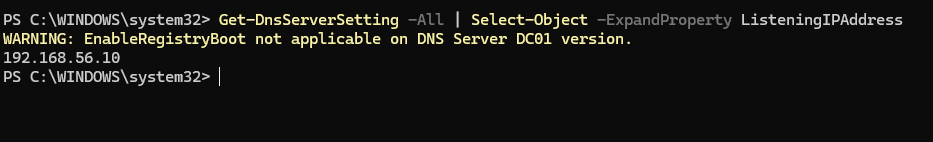

**Result:** Only `192.168.56.10` was returned. The unwanted NAT address did not reappear during the test.

The remediation successfully passed the immediate DNS registration verification. Client-side DNS resolution and domain connectivity remain separate validation steps.

#### Key Lessons

- Multihomed domain controllers require careful DNS interface configuration.
- Disabling DNS client registration on an adapter may not prevent other Windows services from publishing its address.
- Authoritative DNS zone queries provide direct evidence of stored resource records.
- Controlled reproduction and post-remediation testing are essential for validating a configuration change.
- Microsoft documentation provides an authoritative basis for troubleshooting and remediation.

**Reference:** [Microsoft KB 2023004 — Avoid registering unwanted NICs in DNS on a multihomed domain controller](https://learn.microsoft.com/en-us/troubleshoot/windows-server/networking/unwanted-nic-registered-dns-mulithomed-dc)

## 5. Active Directory Client Administration

### 5.1 Windows 11 Domain Join and Verification

**Objective**

Configure a Windows 11 Enterprise workstation to communicate with the Windows Server 2025 domain controller, join the `lab.test` domain, and verify domain connectivity and authentication.

**Active Directory Domain Verification**

On DC01, verified the Active Directory domain configuration:

```powershell
Get-ADDomain | Format-List *
```

The results confirmed that the domain and forest are named `lab.test`, the domain functional level is `Windows2025Domain`, and DC01 holds the PDC Emulator role.

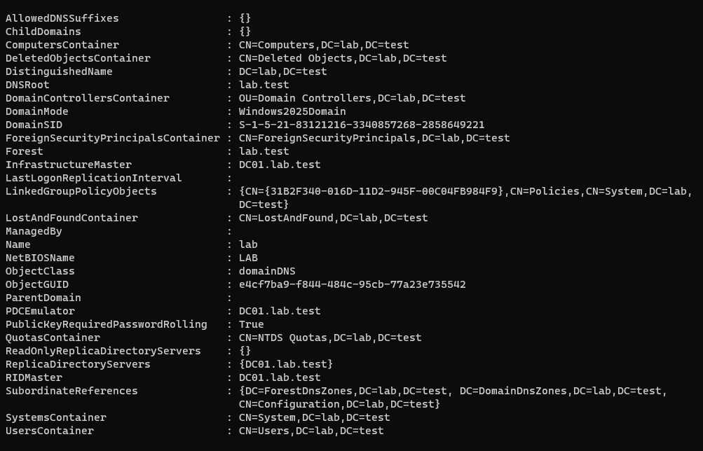


**Client Network Configuration**

Configured the Windows 11 virtual machine to use the VirtualBox host-only network, allowing communication with DC01 on the `192.168.56.0/24` subnet.

The workstation received an IPv4 address through the VirtualBox host-only DHCP service.

Configured the workstation to use the domain controller as its DNS server:

```powershell
Set-DnsClientServerAddress -InterfaceAlias "Ethernet" -ServerAddresses 192.168.56.10
```

This configuration allows the workstation to resolve Active Directory DNS records through the domain controller.

**DNS and Domain Controller Discovery**

Verified TCP connectivity to the DNS service:

```powershell
Test-NetConnection 192.168.56.10 -Port 53
```

Queried the domain controller's LDAP service location records:

```powershell
nslookup -type=SRV _ldap._tcp.dc._msdcs.lab.test
```

Verified domain controller discovery:

```powershell
nltest /dsgetdc:lab.test
```
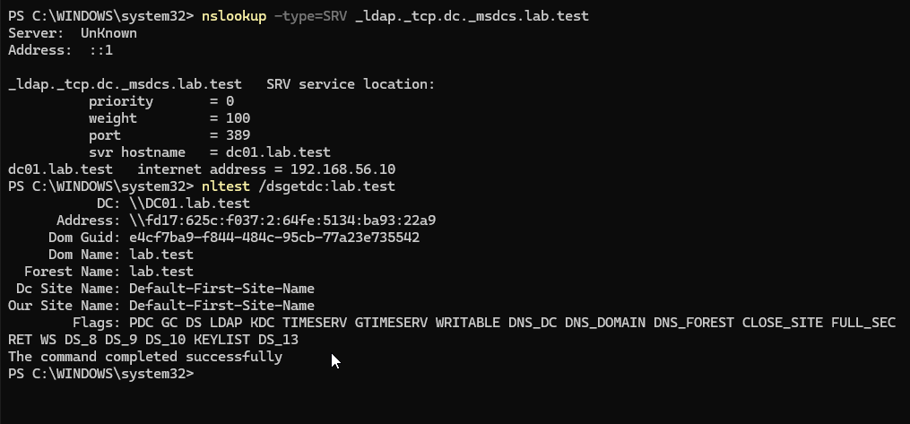
The results confirmed that the workstation could discover `DC01` through Active Directory DNS.

**Domain Join**

Joined the Windows 11 workstation to the domain using PowerShell:

```powershell
Add-Computer -DomainName "lab.test" -Credential "LAB\Administrator" -Restart
```

The initial attempt to join the domain failed because the domain controller virtual machine was powered off.

After starting DC01 and confirming domain controller discovery, repeated the domain join successfully.

**Post-Join Verification**

Verified domain membership:

```powershell
Get-CimInstance Win32_ComputerSystem |
Select-Object Name, Domain, PartOfDomain
```

The output confirmed:

- Domain: `lab.test`
- PartOfDomain: `True`

Verified the computer's secure channel with the domain:

```powershell
Test-ComputerSecureChannel -Verbose
```

Result: `True`

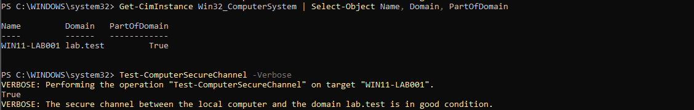

**Active Directory Computer Account Verification**

On DC01, queried the workstation's computer account:

```powershell
Get-ADComputer -Identity "WIN11-LAB001" -Properties Enabled, DistinguishedName, PasswordLastSet |
Select-Object Name, Enabled, DistinguishedName, PasswordLastSet
```

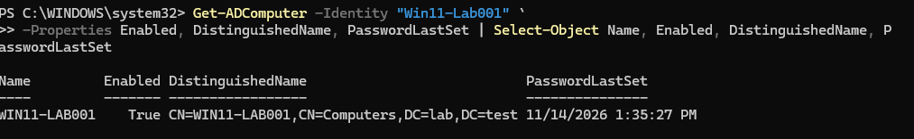


Confirmed that Active Directory had automatically created and enabled the workstation's computer account in the default `CN=Computers` container.

**Outcome**

Successfully joined the Windows 11 workstation to `lab.test`, verified domain controller discovery, confirmed domain membership, and validated the computer's secure channel.

This exercise demonstrated the relationship between DNS service discovery, network connectivity, Active Directory computer accounts, and domain authentication.


### 5.2 Active Directory Organizational Units and Security Groups

**Objective**

Create a structured Active Directory hierarchy for organizing computer accounts, user accounts, and security groups. Move the domain-joined Windows 11 workstation into its designated Organizational Unit and create a security group for future access control exercises.

**Organizational Unit Configuration**

Created a parent Organizational Unit named `Lab` within the `lab.test` domain:

```powershell
New-ADOrganizationalUnit -Name "Lab" -Path "DC=lab,DC=test"
```

Created three child OUs to separate workstation, user, and group objects:

```powershell
New-ADOrganizationalUnit -Name "Workstations" -Path "OU=Lab,DC=lab,DC=test"

New-ADOrganizationalUnit -Name "Users" -Path "OU=Lab,DC=lab,DC=test"

New-ADOrganizationalUnit -Name "Groups" -Path "OU=Lab,DC=lab,DC=test"
```

Verified the resulting hierarchy:

```powershell
Get-ADOrganizationalUnit -Filter * |
Select-Object Name, DistinguishedName
```

The query confirmed that `Workstations`, `Users`, and `Groups` were created beneath `OU=Lab`.

**OU Structure Verification**

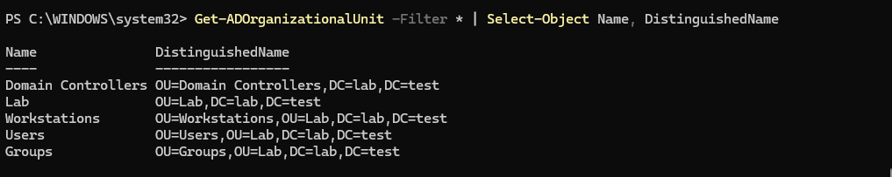

**Workstation Account Organization**

Moved the existing domain-joined workstation from the default `CN=Computers` container into the custom Workstations OU:

```powershell
Get-ADComputer -Identity "WIN11-LAB001" |
Move-ADObject -TargetPath "OU=Workstations,OU=Lab,DC=lab,DC=test"
```

Verified the workstation's new Distinguished Name:

```powershell
Get-ADComputer -Identity "WIN11-LAB001" |
Select-Object Name, DistinguishedName
```

Confirmed:

`CN=WIN11-LAB001,OU=Workstations,OU=Lab,DC=lab,DC=test`

This operation changed the computer account's location within Active Directory without modifying the workstation's operating system, network configuration, or domain membership.

**Security Group Creation**

Created a global security group named `IT-Support` inside the Groups OU:

```powershell
New-ADGroup `
    -Name "IT-Support" `
    -GroupScope Global `
    -GroupCategory Security `
    -Path "OU=Groups,OU=Lab,DC=lab,DC=test"
```

Verified the security group's properties:

```powershell
Get-ADGroup -Identity "IT-Support" |
Select-Object Name, GroupScope, GroupCategory, DistinguishedName |
Format-List
```

Confirmed that the group was created with Global scope and Security category, under the intended OU.

**Security Group Verification**

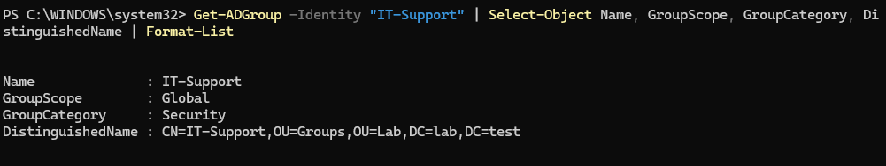

**Outcome**

Successfully created and verified a custom Active Directory OU hierarchy, reorganized a domain-joined workstation's computer account, and provisioned a global security group using PowerShell.

This exercise demonstrated directory object management, Distinguished Name interpretation, OU hierarchy design, and the distinction between organizational containers and security groups.

No users have been added to the security group, and no resource permissions have been assigned.


### 5.3 Active Directory User Provisioning and Group Membership

**Objective:** Provision a domain user in the designated Users OU, configure initial authentication requirements, assign security group membership, and validate the user's domain logon on a Windows 11 workstation.

**Environment:** `DC01.lab.test` (Windows Server 2025), `WIN11-LAB001` (Windows 11), domain `lab.test`.

#### Create and verify a domain user

Created a disabled user account in `OU=Users,OU=Lab,DC=lab,DC=test` to allow verification before activation:

```powershell
New-ADUser `
    -Name "Alex Morgan" `
    -GivenName "Alex" `
    -Surname "Morgan" `
    -SamAccountName "amorgan" `
    -UserPrincipalName "amorgan@lab.test" `
    -Path "OU=Users,OU=Lab,DC=lab,DC=test" `
    -Enabled $false
```

Verified the account's identity, distinguished name, and initial state:

```powershell
Get-ADUser -Identity "amorgan" -Properties Enabled,UserPrincipalName |
    Select-Object Name,SamAccountName,UserPrincipalName,Enabled,DistinguishedName |
    Format-List
```

Confirmed the account was initially disabled and located at `CN=Alex Morgan,OU=Users,OU=Lab,DC=lab,DC=test`.

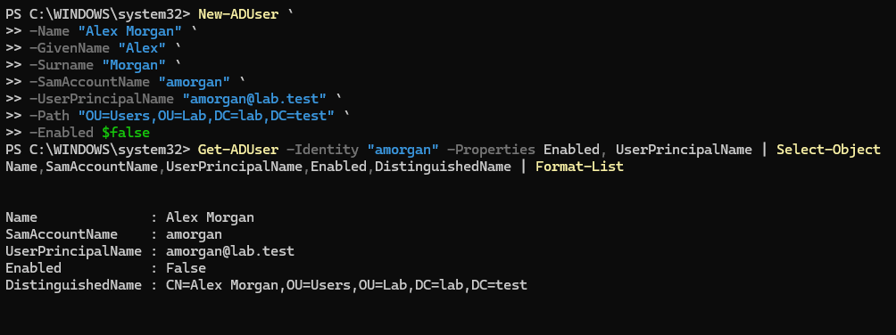

#### Configure password and enable account

Assigned a temporary password securely, required a password change at the next sign-in, and enabled the account:

```powershell
Set-ADAccountPassword -Identity "amorgan" -Reset `
    -NewPassword (Read-Host "Enter temporary password" -AsSecureString)

Set-ADUser -Identity "amorgan" -ChangePasswordAtLogon $true
Enable-ADAccount -Identity "amorgan"
```

Verified the account status:

```powershell
Get-ADUser -Identity "amorgan" -Properties pwdLastSet,PasswordLastSet,Enabled |
    Select-Object Name,Enabled,pwdLastSet,PasswordLastSet |
    Format-List
```

Observed `Enabled : True` and `pwdLastSet : 0`. The zero value is consistent with **User must change password at next logon**; `PasswordLastSet` may appear blank in this state.

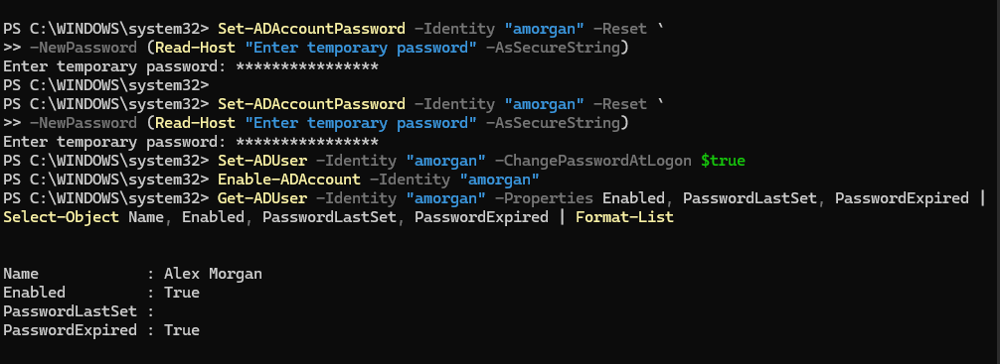

#### Assign and verify security group membership

Added the user to the previously created `IT-Support` global security group:

```powershell
Add-ADGroupMember -Identity "IT-Support" -Members "amorgan"

Get-ADGroupMember -Identity "IT-Support" |
    Select-Object Name,SamAccountName,ObjectClass
```

Verified `Alex Morgan` (`amorgan`) appeared as a user member of the group. Group membership alone does not grant administrative privileges or access to resources unless permissions are assigned to that group.

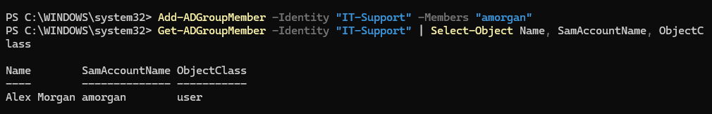

#### Validate domain authentication on Windows 11

Signed in to `WIN11-LAB001` as `amorgan@lab.test` using the temporary password and completed the required password change. Verified the signed-in identity and security group membership:

```powershell
whoami
whoami /groups | findstr /i "IT-Support"
```

The logon succeeded and the user's access token included `LAB\IT-Support`.

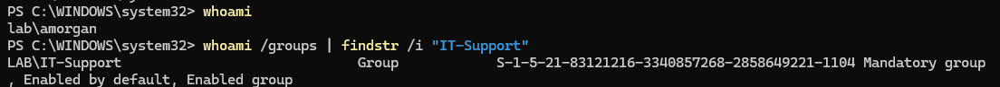

**Result:** Successfully provisioned and enabled a domain user, enforced an initial password change, assigned group membership, and validated domain authentication and the resulting access token on a Windows 11 domain member.

### 5.4 Group Policy Configuration and Time Synchronization Troubleshooting

**Objective:** Create and link a workstation-scoped Group Policy Object (GPO), configure an inactivity lock policy, troubleshoot a failed computer policy refresh, and verify successful policy application.

#### Create and link a workstation GPO

Using **Group Policy Management** on `DC01`, created `LAB - Workstation Security Baseline` and linked it to:

`OU=Workstations,OU=Lab,DC=lab,DC=test`

This OU contains the `WIN11-LAB001` computer account. The GPO was linked at the workstation OU rather than the domain root to limit its intended scope.

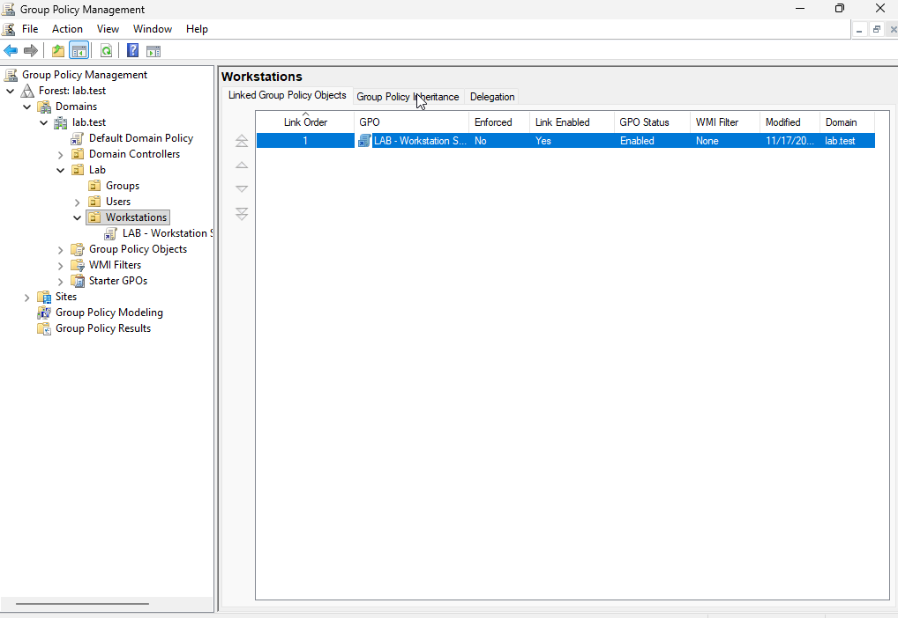

#### Configure an inactivity security policy

Edited the GPO using the following path:

**Computer Configuration → Policies → Windows Settings → Security Settings → Local Policies → Security Options**

Enabled **Interactive logon: Machine inactivity limit** and configured **600 seconds (10 minutes)**.

Because this is a computer policy, it is targeted at the workstation regardless of which domain user signs in.

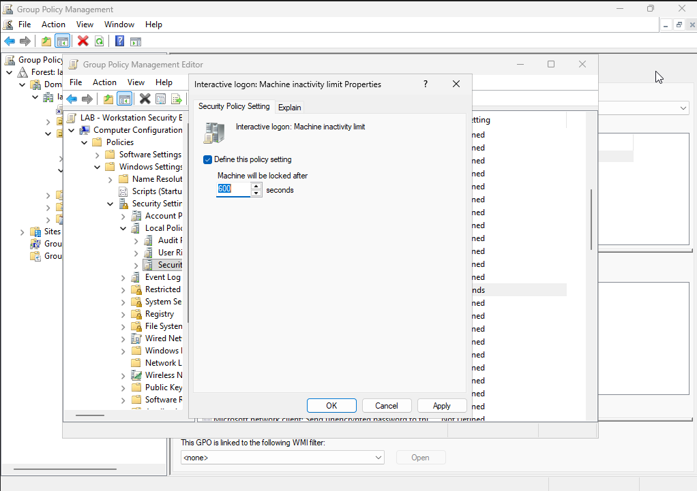

#### Troubleshoot failed computer policy refresh

On `WIN11-LAB001`, ran:

```powershell
gpupdate /force
```

The **computer policy update failed**, reporting that the workstation's clock was not synchronized with a domain controller. The **user policy update succeeded**.

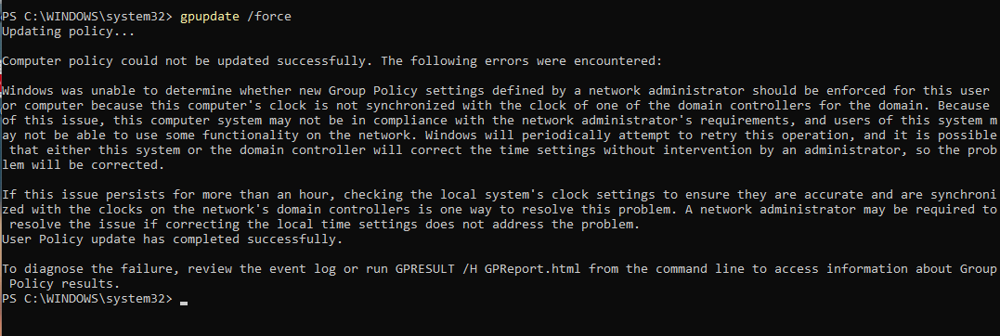

Investigated the Windows Time configuration on both systems:

```powershell
w32tm /query /status
w32tm /query /source
w32tm /query /configuration
```

Initial findings:

- `WIN11-LAB001` identified `DC01.lab.test` as its time source, but the clocks were not currently aligned.
- `DC01` reported `Local CMOS Clock` as its time source.
- Both virtual machines were configured for Pacific Time; checking UTC confirmed a real clock difference rather than merely a display time-zone difference.
- `DC01` held the PDC Emulator role and was not configured to use a manual external NTP peer.

### Diagnosing Domain Controller Time Synchronization

Measured the time difference between `WIN11-LAB001` and `DC01`:

```powershell
w32tm /stripchart /computer:DC01.lab.test /samples:5 /dataonly
```

The offset was approximately **+3,484 seconds (58 minutes)**, exceeding the typical five-minute Kerberos clock-skew tolerance and providing a likely explanation for the Group Policy processing failure.

#### Investigating the DC01 Time Source

On `DC01`, examined the Windows Time service:

```powershell
w32tm /query /status
w32tm /query /source
w32tm /query /configuration
```

The initial configuration reported:

```text
Source: Local CMOS Clock
Type: NT5DS
NtpServer Enabled: 1
```

**Finding:** DC01 was using its local system clock rather than synchronizing with an external NTP source.

Although `NT5DS` normally allows domain-joined computers to synchronize through the Active Directory time hierarchy, DC01 held the PDC Emulator FSMO role and had no upstream domain controller from which to obtain authoritative time.

The local clock had become approximately 58 minutes ahead of the correct time.

#### Investigating NTP Service and Firewall Configuration

Verified that the Windows Time service was running:

```powershell
Get-Service W32Time
```

Confirmed that UDP port 123 was bound:

```powershell
Get-NetUDPEndpoint -LocalPort 123 |
    Select-Object LocalAddress,LocalPort,OwningProcess
```

Attempted to locate the Windows Time firewall rule group:

```powershell
Get-NetFirewallRule -DisplayGroup "Windows Time Service"
```

The command returned an error because no firewall rule group with that display name was found.

Rather than assuming NTP traffic was blocked, inspected firewall rules directly by protocol and port:

```powershell
Get-NetFirewallPortFilter |
    Where-Object {
        $_.Protocol -eq "UDP" -and $_.LocalPort -eq "123"
    } |
    Get-NetFirewallRule |
    Select-Object DisplayName,Enabled,Direction,Action
```

The results confirmed an enabled inbound rule allowing UDP port 123.

**Finding:** The NTP provider was enabled, the operating system had an active UDP 123 endpoint, and an inbound firewall allowance existed. The investigation therefore continued toward the time source rather than making unnecessary firewall changes.

#### Verifying External NTP Connectivity

On `DC01`, queried an external NTP server:

```powershell
w32tm /stripchart /computer:time.windows.com /samples:3 /dataonly
```

The first request timed out, but subsequent requests succeeded and reported offsets of approximately:

```text
-3484.7398182s
-3484.7437866s
```

This independently confirmed that DC01's clock was approximately 58 minutes ahead of the external reference.

#### Configuring the PDC Emulator's Time Source

Configured DC01 to synchronize with an external NTP peer:

```powershell
w32tm /config /manualpeerlist:"time.windows.com,0x8" /syncfromflags:manual /reliable:yes /update
```

Verified the configuration:

```powershell
w32tm /query /configuration
```

The updated configuration showed:

```text
Type: NTP
NtpServer: time.windows.com,0x8
```

Restarted Windows Time and requested synchronization:

```powershell
Restart-Service W32Time
w32tm /resync /rediscover
```

#### Verifying Remediation

On `WIN11-LAB001`, repeated the time-offset measurement:

```powershell
w32tm /stripchart /computer:DC01.lab.test /samples:5 /dataonly
```

The resulting offsets decreased from approximately −1.323 seconds to −0.381 seconds, confirming that the workstation and domain controller clocks were now closely synchronized.

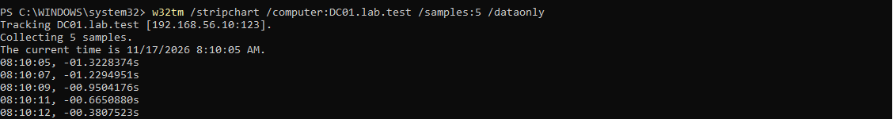

Repeated Group Policy processing:

```powershell
gpupdate /force
```

Both computer and user policy updates completed successfully.

Verified the applied Group Policy Objects:

```powershell
gpresult /scope computer /r
```

The results included:

```text
Applied Group Policy Objects
-----------------------------
LAB - Workstation Security Baseline
Default Domain Policy
```

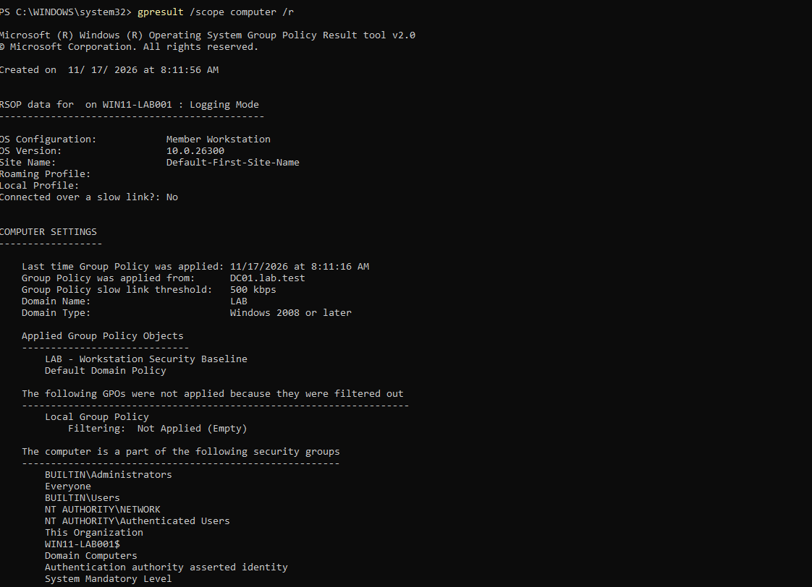

#### Troubleshooting Outcome

The investigation identified an incorrectly synchronized PDC Emulator clock as the likely cause of the Group Policy processing failure.

Configuring DC01 with an external NTP source corrected the clock discrepancy and restored successful Group Policy processing.

The exercise demonstrated systematic troubleshooting across Windows Time, NTP, Windows Firewall, Active Directory authentication, and Group Policy.

### 5.5 Completed Exercises and Next Steps

**Completed:**
- Verified the effective 600-second workstation inactivity timeout on `WIN11-LAB001`.
- Created and deployed a workstation security baseline GPO.
- Troubleshot Group Policy processing failures caused by domain time synchronization.
- Configured a security-filtered GPO targeting a specific computer security group.
- Investigated a Group Policy application failure involving Kerberos authentication and security group authorization.

**Remaining Exercises:**
- Practice account unlocks, password resets, and user lifecycle administration.
- Investigate additional domain authentication, DNS, and connectivity scenarios.
- Build reusable PowerShell administration scripts.

## 6. Group Policy Security Filtering and Kerberos Troubleshooting

### 6.1 USB Restriction Pilot Configuration

**Objective:** Configure a security-filtered Group Policy Object (GPO) that restricts removable storage access on selected domain workstations without affecting every computer in the Workstations OU.

This exercise demonstrates the relationship between Active Directory security groups, GPO permissions, organizational unit linking, and computer-side Group Policy processing.

**Lab Environment:**

- **Domain Controller:** `DC01.lab.test`
- **Domain:** `lab.test`
- **Client Workstation:** `WIN11-LAB001`
- **Target OU:** `OU=Workstations,OU=Lab,DC=lab,DC=test`
- **Security Group:** `GPO-USB-Restriction-Pilot`
- **GPO:** `LAB - USB Storage Restriction Pilot`

#### 6.1.1 Create the Pilot Security Group

Created a global security group within the Lab Groups OU using PowerShell on DC01:

```powershell
New-ADGroup `
    -Name "GPO-USB-Restriction-Pilot" `
    -SamAccountName "GPO-USB-Restriction-Pilot" `
    -GroupScope Global `
    -GroupCategory Security `
    -Path "OU=Groups,OU=Lab,DC=lab,DC=test" `
    -Description "Pilot group for removable storage restriction policy"
```

Verified the group:

```powershell
Get-ADGroup -Identity "GPO-USB-Restriction-Pilot" |
    Select-Object Name, GroupScope, GroupCategory, DistinguishedName
```

#### 6.1.2 Add the Workstation to the Pilot Group

Added the Windows 11 computer account to the security group:

```powershell
Add-ADGroupMember `
    -Identity "GPO-USB-Restriction-Pilot" `
    -Members "WIN11-LAB001$"
```

Verified membership:

```powershell
Get-ADGroupMember -Identity "GPO-USB-Restriction-Pilot" |
    Select-Object Name, SamAccountName, ObjectClass

The output confirmed that `WIN11-LAB001$` was a member of the pilot group with an object class of `computer`.

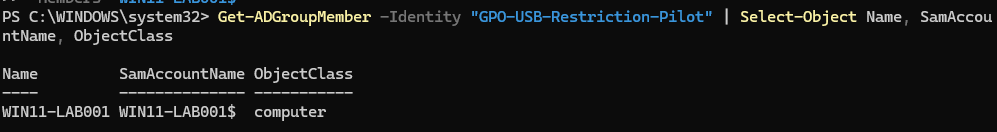

**Technical note:** Security group membership alone does not cause a GPO to apply. The GPO must also be linked within the computer's applicable Active Directory scope, and the computer must have permission to apply it.

#### 6.1.3 Create and Configure the GPO

Created a dedicated Group Policy Object:

```powershell
New-GPO `
    -Name "LAB - USB Storage Restriction Pilot" `
    -Comment "Pilot policy to restrict removable storage access on selected domain workstations"
```

Verified its creation:

```powershell
Get-GPO -Name "LAB - USB Storage Restriction Pilot" |
    Select-Object DisplayName, Id, GpoStatus, CreationTime |
    Format-List
```

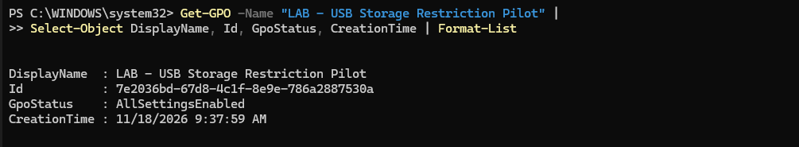

Opened Group Policy Management and configured:

**Computer Configuration → Policies → Administrative Templates → System → Removable Storage Access**

- **Setting:** All Removable Storage classes: Deny all access
- **State:** Enabled

This computer-level restriction denies access to supported removable storage classes on affected workstations, regardless of the user signing in.

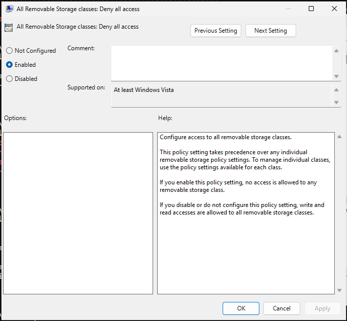

#### 6.1.4 Configure Security Filtering

The default GPO permissions allow `Authenticated Users` to apply the policy. To limit deployment to the pilot group, modified the permissions using PowerShell.

Granted the pilot group permission to apply the GPO:

```powershell
Set-GPPermission `
    -Name "LAB - USB Storage Restriction Pilot" `
    -TargetName "GPO-USB-Restriction-Pilot" `
    -TargetType Group `
    -PermissionLevel GpoApply
```

Changed `Authenticated Users` to read-only access:

```powershell
Set-GPPermission `
    -Name "LAB - USB Storage Restriction Pilot" `
    -TargetName "Authenticated Users" `
    -TargetType Group `
    -PermissionLevel GpoRead `
    -Replace
```

Verified the permissions:

```powershell
Get-GPPermission `
    -Name "LAB - USB Storage Restriction Pilot" `
    -All
```

The resulting permissions were:

| Security Principal | Permission |
|---|---|
| GPO-USB-Restriction-Pilot | GpoApply |
| Authenticated Users | GpoRead |
| Domain Admins | GpoEditDeleteModifySecurity |
| Enterprise Admins | GpoEditDeleteModifySecurity |
| SYSTEM | GpoEditDeleteModifySecurity |

Other default security principals retained their existing permissions.

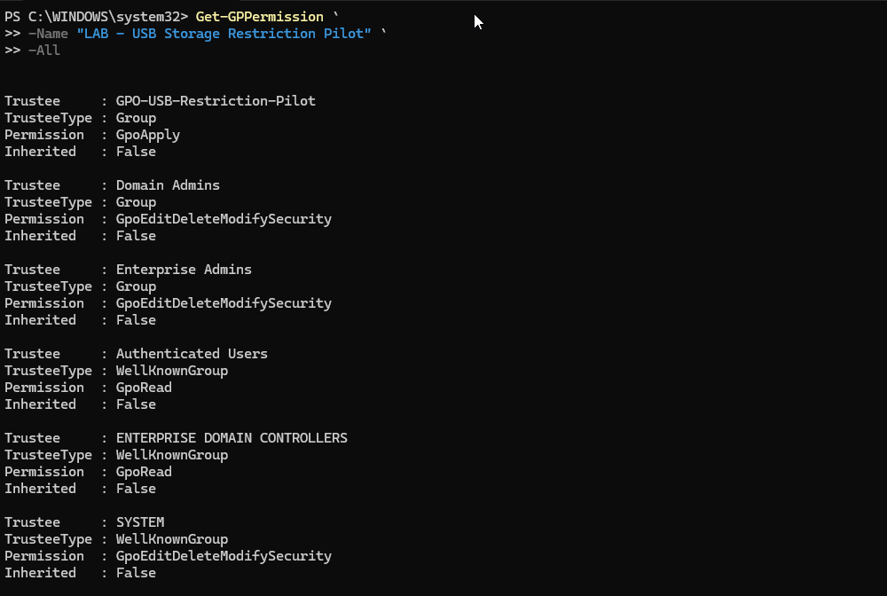

**Technical note:** `GpoRead` allows authenticated computers to read the policy without granting permission to apply it. Members of the pilot group receive `GpoApply`, which includes the necessary read and apply permissions.

#### 6.1.5 Link the GPO to the Workstations OU

Linked the USB restriction GPO to the existing Workstations OU:

```powershell
New-GPLink `
    -Name "LAB - USB Storage Restriction Pilot" `
    -Target "OU=Workstations,OU=Lab,DC=lab,DC=test"
```

The resulting link was enabled, with enforcement disabled and link order 2.

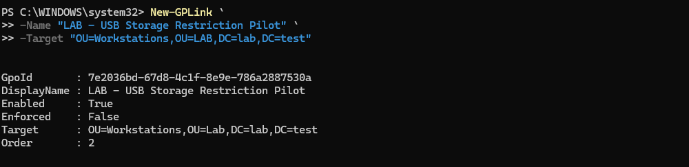

At this point, a workstation needed to satisfy two conditions to apply the GPO:

1. Reside within the linked Workstations OU or an applicable child OU.
2. Possess `GpoApply` permission through membership in `GPO-USB-Restriction-Pilot`.

The configuration was complete, but subsequent client-side verification revealed that the policy was not initially applying. This required additional troubleshooting, documented in the following section.


### 6.2 Troubleshooting GPO Application and Kerberos Authentication

#### 6.2.1 Initial Problem: Security-Filtered GPO Not Applying

After configuring and linking the USB restriction GPO, restarted `WIN11-LAB001` and forced Group Policy processing:

```powershell
gpupdate /force
```

Checked the applied computer policies:

```powershell
gpresult /scope computer /r
```

**Observed behavior:**

- `LAB - Workstation Security Baseline` applied successfully.
- `LAB - USB Storage Restriction Pilot` was absent from the applied GPO list.
- The computer's reported security groups did not include `GPO-USB-Restriction-Pilot`.
- Repeated Group Policy updates and workstation restarts did not resolve the issue.

This suggested that the problem was specific to the security-filtered policy rather than a general failure of domain connectivity or Group Policy processing.

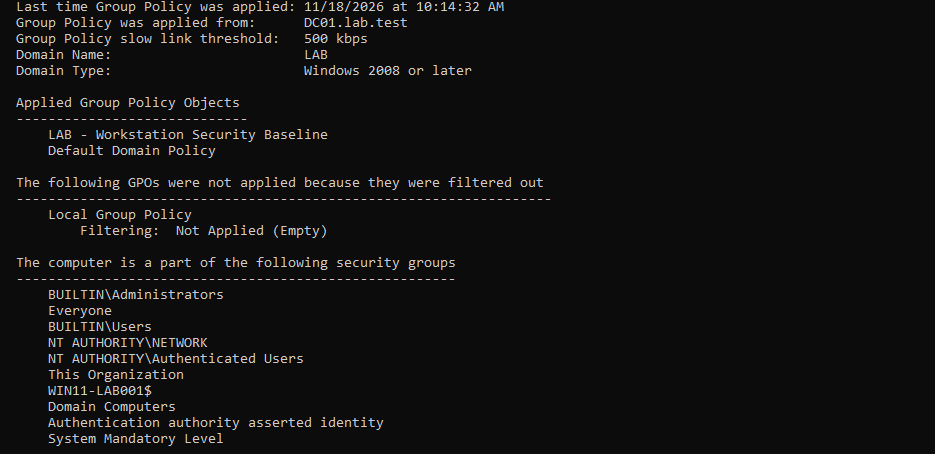

#### 6.2.2 Verify Active Directory Scope and Group Membership

On `DC01`, verified the workstation's OU placement:

```powershell
Get-ADComputer -Identity "WIN11-LAB001" |
    Select-Object Name, DistinguishedName
```

Confirmed the computer was located in:

`CN=WIN11-LAB001,OU=Workstations,OU=Lab,DC=lab,DC=test`

Verified security group membership from both directions:

```powershell
Get-ADGroupMember -Identity "GPO-USB-Restriction-Pilot"

Get-ADComputer -Identity "WIN11-LAB001" -Properties MemberOf |
    Select-Object -ExpandProperty MemberOf
```

Both queries confirmed membership in `GPO-USB-Restriction-Pilot`.

Also verified that:

- The GPO was linked to the correct Workstations OU.
- The pilot group had `GpoApply` permission.
- `Authenticated Users` retained `GpoRead` permission.
- The removable storage restriction was enabled.
- No WMI filter was configured.

These checks reduced the likelihood of an OU placement, group membership, or GPO configuration error.

#### 6.2.3 Isolate the Security Filtering Problem

To determine whether the GPO itself was functional, temporarily changed its security filtering.

First, confirmed that `WIN11-LAB001` was the only computer in the lab's Workstations OU:

```powershell
Get-ADComputer `
    -SearchBase "OU=Workstations,OU=Lab,DC=lab,DC=test" `
    -SearchScope Subtree `
    -Filter * |
    Select-Object Name
```

On `DC01`, temporarily granted `Authenticated Users` permission to apply the policy:

```powershell
Set-GPPermission `
    -Name "LAB - USB Storage Restriction Pilot" `
    -TargetName "Authenticated Users" `
    -TargetType Group `
    -PermissionLevel GpoApply `
    -Replace
```

On `WIN11-LAB001`:

```powershell
gpupdate /force
gpresult /scope computer /r
```

**Result:** The USB restriction GPO appeared in the Applied Group Policy Objects list.

This confirmed that the GPO could be processed successfully when the pilot-group filtering requirement was removed.

Restored the intended security filtering:

```powershell
Set-GPPermission `
    -Name "LAB - USB Storage Restriction Pilot" `
    -TargetName "Authenticated Users" `
    -TargetType Group `
    -PermissionLevel GpoRead `
    -Replace
```

The controlled test narrowed the investigation to security filtering and the computer's authorization context.


#### 6.2.4 Investigate Kerberos Authentication

Because Active Directory group membership and GPO configuration were correct, investigated whether the workstation's Kerberos authentication state reflected its updated security group membership.

Kerberos tickets can contain authorization information that may become outdated following changes to Active Directory group membership.

On `WIN11-LAB001`, enumerated the computer's logon sessions:

```powershell
klist sessions
```

Identified `0x3e7` as the well-known hexadecimal logon session identifier (LUID) for Windows Local System, the security context used for computer-side Group Policy processing.

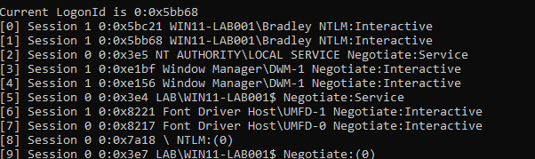

Used this identifier to inspect the Local System Kerberos ticket cache:

```powershell
klist -li 0x3e7
```

The `-li` parameter specifies the logon session to inspect. The output confirmed an active Ticket Granting Ticket (TGT) for `WIN11-LAB001$`, issued through `DC01.lab.test`.

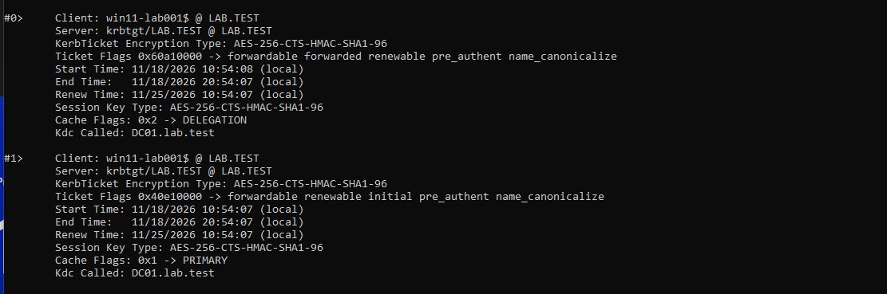

**Working hypothesis:** The computer's existing Kerberos authorization information did not reflect its current membership in `GPO-USB-Restriction-Pilot`.

Although the ticket inspection confirmed an active computer-account TGT, it did not expose the ticket's Privilege Attribute Certificate (PAC) group memberships. Stale authorization information was therefore suspected but not conclusively verified.


#### 6.2.5 Purge the Local System Kerberos Ticket Cache

On `WIN11-LAB001`, opened an elevated PowerShell session and executed:

```powershell
klist -li 0x3e7 purge
```

The command successfully purged the tickets associated with the Local System logon session.

Restarted the workstation:

```powershell
Restart-Computer
```

After the restart, forced Group Policy processing and checked the applied policies:

```powershell
gpupdate /force
gpresult /scope computer /r
```

**Result:** `LAB - USB Storage Restriction Pilot` now appeared alongside the existing workstation security baseline.

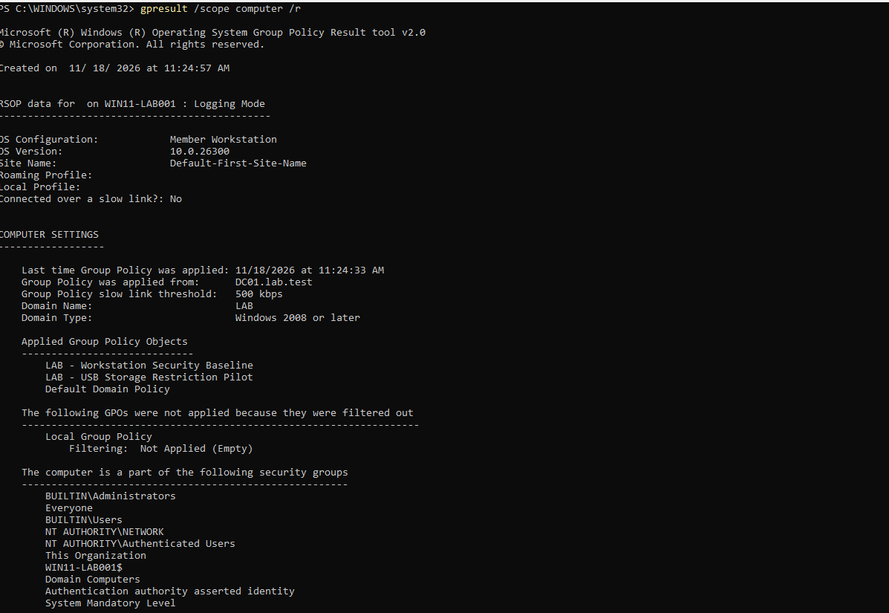

The result was consistent with the hypothesis that the computer's authentication or authorization state had not incorporated the updated group membership.

Because the ticket purge and restart were performed together, the test did not establish which operation independently resolved the issue.

#### 6.2.6 Root Cause Assessment and Lessons Learned

**Most likely cause:** Stale computer-account Kerberos authorization information prevented the security-filtered GPO from applying despite correct Active Directory membership and GPO configuration.

The investigation demonstrated several troubleshooting principles:

1. **Directory membership and effective authorization are different.** A computer can belong to an AD security group while its existing authentication context does not yet reflect that membership.
2. **Successful `gpupdate` execution does not guarantee a particular GPO applied.** Verify the result using `gpresult`.
3. **Controlled configuration changes help isolate failures.** Temporarily granting `Authenticated Users` apply permission demonstrated that the GPO and OU link were functional.
4. **Kerberos tickets are associated with logon sessions.** The Local System ticket cache can be inspected and targeted using `klist -li 0x3e7`.
5. **Conclusions should match the available evidence.** The purge-and-restart sequence resolved the issue, but the original ticket's authorization contents were not captured.

**Production consideration:** Ticket purges and workstation restarts can disrupt authentication sessions and active workloads. These actions should follow appropriate operational procedures.

**Final outcome:** The USB restriction GPO successfully applied to `WIN11-LAB001` with the intended pilot-group security filtering restored.


## 7. Lessons Learned So Far

- DNS name resolution and IP routing solve different problems: a successful lookup does not guarantee connectivity.
- A multihomed server can register addresses that are inappropriate for some client networks.
- Disabling DNS registration on an interface does not automatically remove existing authoritative records.
- `-WhatIf` previews supported PowerShell changes, but does not prove a subsequent operation will succeed.
- Verification should include checking that a configuration issue does not recur.

## 8. Evidence and Documentation

Screenshots will be stored in a `screenshots/` subfolder and embedded inline alongside the relevant implementation or troubleshooting sections. This README will be updated as each stage is completed and verified.

