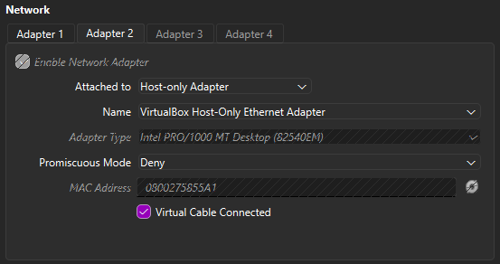
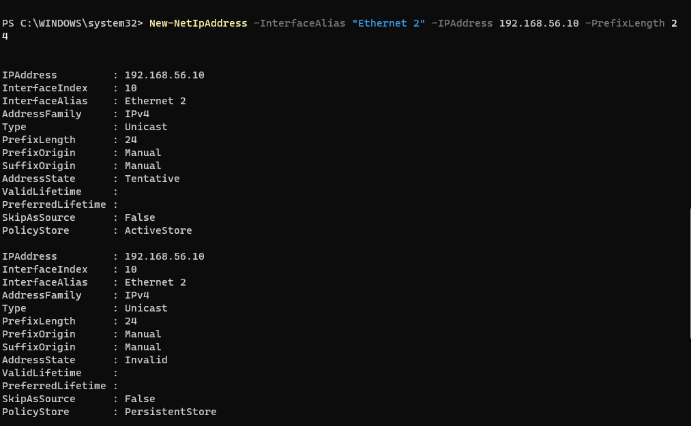
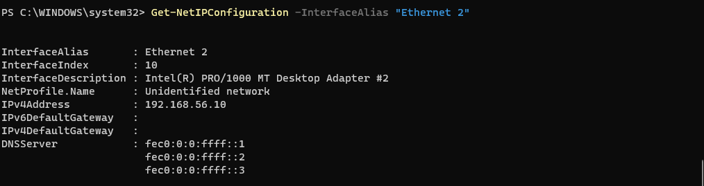
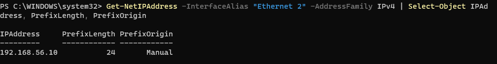
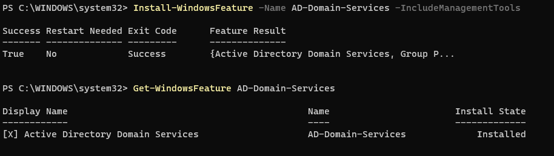
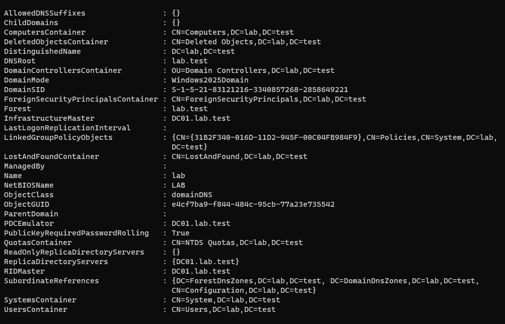
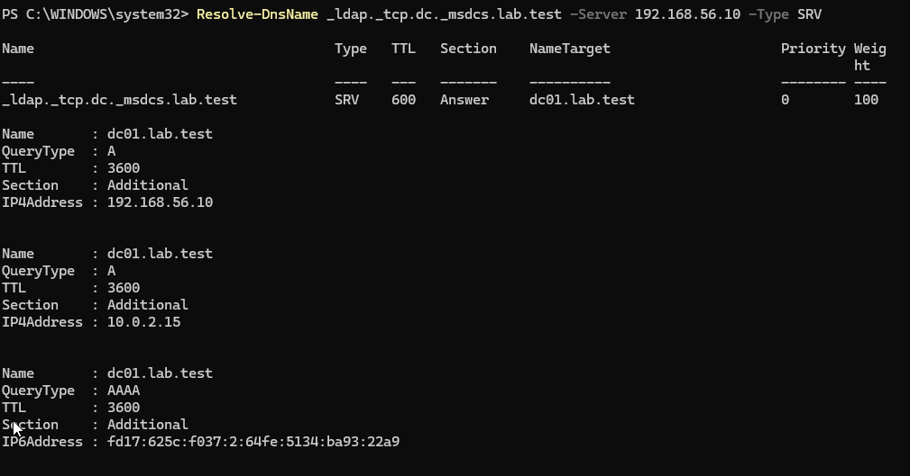
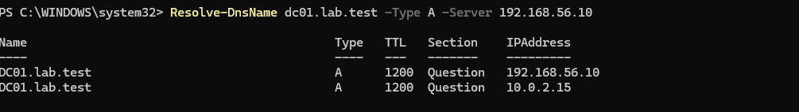
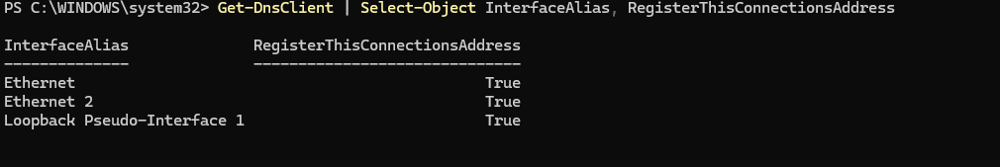
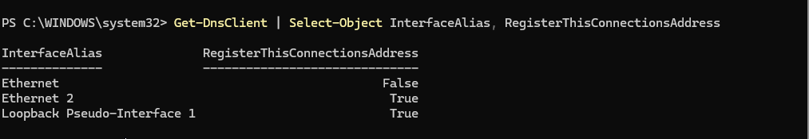

# LAB-002 — Windows Server 2025 Active Directory Deployment

**Category:** Windows Server / Active Directory / Systems Administration  
**Status:** In Progress  
**Environment:** Oracle VirtualBox, Windows Server 2025 Standard Evaluation, Windows 11 Enterprise

## 1. Project Overview

This lab documents the deployment of a Windows Server 2025 Active Directory environment in Oracle VirtualBox. Its purpose is to build practical experience with Windows Server administration, TCP/IP networking, Active Directory Domain Services (AD DS), DNS, PowerShell, and systematic troubleshooting.

The project is being developed incrementally. Completed work and verified results are distinguished from planned exercises.

## 2. Lab Architecture

| Component | Configuration |
|---|---|
| Hypervisor | Oracle VirtualBox 7.2 |
| Domain controller | `DC01` |
| Server OS | Windows Server 2025 Standard Evaluation |
| Active Directory domain | `lab.test` |
| NetBIOS domain | `LAB` |
| Client VM | Windows 11 Enterprise (domain join pending) |
| Host-only subnet | `192.168.56.0/24` |
| DC01 host-only interface (`Ethernet 2`) | `192.168.56.10/24` (static; no default gateway) |
| DC01 NAT interface (`Ethernet`) | `10.0.2.15/24` (VirtualBox NAT) |
| Internal DNS server | `192.168.56.10` |

DC01 has two virtual network interfaces. The **host-only adapter** provides connectivity between lab systems, while the **NAT adapter** provides outbound connectivity. The domain controller hosts authoritative DNS for `lab.test`.


> **Design note:** This multihomed configuration is useful for learning, but a single-homed domain controller is generally simpler to administer. We are investigating unwanted DNS registration associated with the NAT adapter.

## 3. Deployment and Verification

### 3.1 Windows Server Installation

Created a Windows Server 2025 Standard Evaluation virtual machine in VirtualBox and completed installation. Configured the VM with NAT and host-only network adapters.



### 3.2 Static Network Configuration

Configured the host-only interface with static IPv4 address `192.168.56.10/24` and no default gateway. Verified that Windows reported the address as manually configured.

The NAT interface provides an outbound path through VirtualBox; the host-only interface is used for internal Active Directory communication.

**Static IPv4 Address Configuration**



**IPv4 Address Verification**



**Static Address Origin Verification**



### 3.3 Active Directory Domain Services

Installed the AD DS role and management tools:

```powershell
Install-WindowsFeature -Name AD-Domain-Services -IncludeManagementTools
```

**AD DS Role Installation**



Created a new forest and installed DNS:

```powershell
Install-ADDSForest -DomainName "lab.test" -DomainNetbiosName "LAB" -InstallDNS
```

Verified the resulting domain:

```powershell
Get-ADDomain
```

Confirmed that the `NTDS`, `DNS`, `Netlogon`, and `KDC` services were running.

**Active Directory Domain Verification**



### 3.4 DNS Service Discovery

Queried the domain controller locator SRV record:

```powershell
Resolve-DnsName _ldap._tcp.dc._msdcs.lab.test -Server 192.168.56.10 -Type SRV
```

**DNS SRV Record Verification**



The query identified `dc01.lab.test` as an LDAP service target. Inspection of the DNS response also revealed multiple addresses associated with the domain controller, prompting the troubleshooting investigation below.

## 4. Troubleshooting — Multihomed Domain Controller DNS Registration

### Problem

During Active Directory DNS verification, the domain controller hostname `dc01.lab.test` was found to resolve to multiple IPv4 addresses.

Because DC01 uses separate NAT and host-only network adapters, an address registered from the wrong interface could cause domain clients to attempt connections over an unreachable network.

### Diagnosis

Queried the domain controller's DNS server directly to inspect its registered IPv4 addresses:

```powershell
Resolve-DnsName dc01.lab.test -Type A -Server 192.168.56.10
```

**DNS Records Before Remediation**



The query returned two A records:

- `192.168.56.10` — the intended host-only address, reachable by lab clients.
- `10.0.2.15` — the NAT adapter address, not directly reachable from the host-only client network.

This confirmed that DC01 was publishing an address unsuitable for the planned client network.

Examined the DNS registration settings for each network interface:

```powershell
Get-DnsClient | Select-Object InterfaceAlias, RegisterThisConnectionsAddress
```
**DNS Registration Results - Before Remediation**



Initially, both Ethernet interfaces permitted DNS address registration. The DNS Server service was also observed listening on multiple addresses. However, listening for DNS queries and registering a server's own addresses in DNS are separate functions.

### Remediation performed

Disabled DNS client address registration on the NAT adapter:

```powershell
Set-DnsClient -InterfaceAlias "Ethernet" -RegisterThisConnectionsAddress $false
```

**NAT Adapter DNS Registration Disabled**



The previously registered NAT-side A record remained in the authoritative zone. Prepared a targeted removal and previewed it without modifying the zone:

```powershell
Remove-DnsServerResourceRecord -ZoneName "lab.test" -Name "dc01" -RRType "A" -RecordData "10.0.2.15" -WhatIf
```

### Initial Remediation and Verification

Executed the removal command without `-WhatIf` and confirmed the deletion.

A subsequent DNS lookup continued to return both A records, including the unwanted NAT address `10.0.2.15`.

```powershell
Resolve-DnsName dc01.lab.test -Type A -Server 192.168.56.10
```

To determine whether the unwanted record remained in the authoritative DNS zone, queried the DNS resource records directly:

```powershell
Get-DnsServerResourceRecord -ZoneName "lab.test" -Name "dc01" -RRType "A" |
Select-Object HostName, RecordType, RecordData
```

The `RecordData` column displayed the object type `DnsServerResourceRecordA` rather than the underlying IPv4 address.

Used a calculated property to extract the IPv4 address from the nested `RecordData` object:

```powershell
Get-DnsServerResourceRecord -ZoneName "lab.test" -Name "dc01" -RRType "A" |
Select-Object HostName, RecordType,
    @{Name="IPAddress";Expression={$_.RecordData.IPv4Address}}
```

This query returned only `192.168.56.10`, indicating that the unwanted NAT address was no longer present in the authoritative zone at the time of inspection.

### Unexpected Result — DNS Record Reappeared

While exploring an alternative method of inspecting nested PowerShell objects, queried the `RecordData` property directly:

```powershell
Get-DnsServerResourceRecord -ZoneName "lab.test" -Name "dc01" -RRType "A" |
Select-Object -ExpandProperty RecordData
```

Unexpectedly, the output contained both IPv4 addresses:

- `192.168.56.10` — intended host-only address
- `10.0.2.15` — unwanted NAT address

Both commands retrieved DNS resource records from the same zone but used different methods to display their properties.

To rule out differences in PowerShell object formatting, repeated the DNS resource record query using both a calculated property and Select-Object -ExpandProperty RecordData.

Both commands returned the same two IPv4 addresses, confirming that the unwanted record was present in the authoritative DNS zone.

This indicated that deleting the existing record had not provided a persistent resolution. Further investigation was required to identify the mechanism responsible for DNS registration.

### Further Investigation — DNS Server Configuration

Verified that DNS client address registration remained disabled on the NAT adapter, despite the unwanted A record returning.

```powershell
Get-DnsClient |
Where-Object InterfaceAlias -in "Ethernet", "Ethernet 2" |
Select-Object InterfaceAlias, RegisterThisConnectionsAddress
```

Examined the IP addresses on which the DNS Server service was configured to listen:

```powershell
Get-DnsServerSetting -All | Select-Object -ExpandProperty ListeningIPAddress
```
The results included both 10.0.2.15 and 192.168.56.10, along with IPv6 addresses.

This confirmed that DNS Server was configured to listen on both IPv4 interfaces. However, DNS listening configuration and DNS record registration are separate functions, so this finding did not establish the cause of the unwanted A record.

Inspected the DNS Server registry configuration:

```powershell
Get-ItemProperty -Path "HKLM:\SYSTEM\CurrentControlSet\Services\DNS\Parameters" -Name PublishAddresses
```
The PublishAddresses registry value was absent, indicating that no explicit address publication restriction had been configured through this setting.

### Controlled Test — DNS Registration

To investigate the recurring DNS record, verified that DNS client registration remained disabled on the NAT adapter.

Removed the unwanted `10.0.2.15` A record and queried the authoritative DNS zone to establish a clean baseline. Only `192.168.56.10` remained.

Triggered a DNS registration refresh:

```powershell
ipconfig /registerdns
```

Queried the authoritative DNS zone again:

```powershell
Get-DnsServerResourceRecord -ZoneName "lab.test" -Name "dc01" -RRType "A" |
Select-Object -ExpandProperty RecordData
```

The unwanted `10.0.2.15` A record had returned.


This reproduced the issue following a DNS registration refresh, despite DNS client registration being disabled on the NAT adapter. The result narrowed the investigation but did not conclusively identify the component responsible for publishing the address.

Restricted DNS Server to the host-only interface using PowerShell:

```powershell
$DnsServerSettings = Get-DnsServerSetting -All
$DnsServerSettings.ListeningIPAddress = @("192.168.56.10")
Set-DnsServerSetting -InputObject $DnsServerSettings
```

Verified the configuration:

```powershell
Get-DnsServerSetting -All |
Select-Object -ExpandProperty ListeningIPAddress
```

The output confirmed that DNS Server was listening only on `192.168.56.10`.

Also inspected the DNS zone's NS records and confirmed that `dc01.lab.test` remained the designated name server.

#### Validation

Queried the authoritative DNS zone and confirmed that the unwanted `10.0.2.15` A record was no longer present.

Repeated the registration test:

```powershell
ipconfig /registerdns
```

Then queried the authoritative zone:

```powershell
Get-DnsServerResourceRecord -ZoneName "lab.test" -Name "dc01" -RRType "A" |
Select-Object -ExpandProperty RecordData
```

**Result:** Only `192.168.56.10` was returned. The unwanted NAT address did not reappear during the test.

The remediation successfully passed the immediate DNS registration verification. Client-side DNS resolution and domain connectivity remain separate validation steps.

#### Key Lessons

- Multihomed domain controllers require careful DNS interface configuration.
- Disabling DNS client registration on an adapter may not prevent other Windows services from publishing its address.
- Authoritative DNS zone queries provide direct evidence of stored resource records.
- Controlled reproduction and post-remediation testing are essential for validating a configuration change.
- Microsoft documentation provides an authoritative basis for troubleshooting and remediation.

**Reference:** [Microsoft KB 2023004 — Avoid registering unwanted NICs in DNS on a multihomed domain controller](https://learn.microsoft.com/en-us/troubleshoot/windows-server/networking/unwanted-nic-registered-dns-mulithomed-dc)
## 5. Planned Exercises

- Configure Windows 11 client networking and join `lab.test`.
- Create and manage Active Directory users, groups, and organizational units.
- Configure and test Group Policy.
- Troubleshoot domain authentication, DNS, and connectivity issues.
- Build reusable PowerShell administration scripts.

## 6. Lessons Learned So Far

- DNS name resolution and IP routing solve different problems: a successful lookup does not guarantee connectivity.
- A multihomed server can register addresses that are inappropriate for some client networks.
- Disabling DNS registration on an interface does not automatically remove existing authoritative records.
- `-WhatIf` previews supported PowerShell changes, but does not prove a subsequent operation will succeed.
- Verification should include checking that a configuration issue does not recur.

## 7. Evidence and Documentation

Screenshots will be stored in a `screenshots/` subfolder and embedded inline alongside the relevant implementation or troubleshooting sections. This README will be updated as each stage is completed and verified.

